<div align="center">



[](https://git.io/typing-svg)

[](https://www.lanaiw.top/)
[](https://space.bilibili.com/3546836998556622)
[](https://x.com/Lanmbsn)
[](mailto:lanaiw2025@163.com)

</div>


## 关于我

> 「静立巅峰，眺望心之狂野。」

一个把想法快速变成能跑的东西的人。主战场在 **AI Agent 编排**、**AI 影视 / 视觉创作**、**实用型财务工具** 三条线上 —— 不追求炫技，只追求「装上去就能用，跑起来就有效」。

比起堆砌概念，更相信一件事：**能跑通、能被验收、能交付，才算真的做完了。**


## 角色属性

<table>
<tr>
<td width="50%" valign="top">

**称号** `TITLE`
AI Agent 编排者

**职业** `CLASS`
全栈工程师 / 工具制造者

**阵营** `ALIGNMENT`
实用主义 · 交付优先

</td>
<td width="50%" valign="top">

**等级** `LEVEL`
持续升级中

**活动区域** `REGION`
China · Windows / Electron 生态

**装备倾向** `LOADOUT`
TypeScript 主手 · MCP 副手

</td>
</tr>
</table>

### 状态面板

```text
HP  生命值  ███████████████████░  96   熬夜写代码的耐力
MP  魔力值  ████████████████░░░░  82   灵感储备
EXP 经验值  ██████████████░░░░░░  71   距离下一次升级
```

### 技能树

```text
AGENT ORCHESTRATION   ██████████████████░░  92   把外部 Agent 编排成可靠流水线
WORKFLOW AUTOMATION   ██████████████████░░  90   让重复劳动彻底消失
MCP TOOLCHAIN         █████████████████░░░  88   工具链设计与协议对接
AI FILM & VISUAL      █████████████████░░░  85   小说 → 剧本 → 分镜 → 成片
FRONTEND ENGINEERING  ████████████████░░░░  82   Electron / React / Vue 桌面端
FINANCE & ERP         ███████████████░░░░░  78   小微企业财税系统
```

### 天赋

| 天赋 | 说明 |
| :--- | :--- |
| **运行时证据验收** | 不接受「应该能跑」，只认跑出来的结果 |
| **失败自动返修** | 一次不通过就再来一次，直到真正通过 |
| **开箱即用主义** | 反感堆配置，能一步到位绝不分三步 |
| **全链路思维** | 从需求到交付，每一环都要能自己接手 |


## 技术栈

<div align="center">


</div>


## 任务日志

### 主线任务 · AI Agent 编排

<table>
<tr>
<td width="50%" valign="top">

**[tianshu-mcp](https://github.com/lanlan0811/tianshu-mcp)** `10 stars`

天枢 harness × AI-Agent 编排 **MCP Server**。
把外部 Agent 拉来干活，用**运行时证据**做客观验收，不通过就自动返修，直到真正跑通。

`TypeScript` · `MCP` · `Apache-2.0`

</td>
<td width="50%" valign="top">

**[Tianshu-harness](https://github.com/lanlan0811/Tianshu-harness)**

终端编码 Agent，基于 harness 框架，带 CVM / 自我认知 / 共识记忆，针对 DeepSeek V4 前缀缓存优化。

`TypeScript` · `Apache-2.0`

</td>
</tr>
</table>

### 主线任务 · AI 影视 / 视觉创作

<table>
<tr>
<td width="100%" valign="top">

**[toonflow-2.0](https://github.com/lanlan0811/toonflow-2.0)** `9 stars`

本地化 AI 影视 / 视觉内容工作台，基于 HBAI-Ltd Toonflow 深度二次开发。
覆盖 **小说 → 剧本 → 分镜 → 图像/视频生成** 全流程；支持分镜导入与资产关联、可重试的短剧工作流、商品视觉工厂、无限画布。

`TypeScript` · `Electron` · `Apache-2.0`

</td>
</tr>
</table>

### 支线任务 · 财务 / ERP 工具

<table>
<tr>
<td width="50%" valign="top">

**[erp-tax](https://github.com/lanlan0811/erp-tax)**

面向中国个体工商户与小微企业的轻量独立财务/ERP 系统。开箱即用，不堆配置。

`TypeScript` · `AGPL-3.0`

</td>
<td width="50%" valign="top">

**[Personal-finance-Windows-x64](https://github.com/lanlan0811/Personal-finance-Windows-x64)**

个人记账桌面端 Demo，学习 Trae IDE 期间的实战产物。

`JavaScript` · `Windows x64`

</td>
</tr>
</table>


## 成就

```text
[ 已解锁 ]  首次交付         让一个 AI Agent 真正跑通了完整闭环
[ 已解锁 ]  开源首星         tianshu-mcp 拿到第 1 颗 Star
[ 已解锁 ]  全链路制作者     从需求、设计到落地，一个人走完全程
[ 已解锁 ]  深夜施工队       在凌晨仍然保持提交记录
[ 进行中 ]  生态构建者       把工具串成体系，而不只是零散脚本
[ 未解锁 ]  ???              继续做下去自然会知道
```


## 好感度

想聊 AI Agent、MCP、工作流自动化，或者只是想看看在做什么 —— 都欢迎。

<div align="center">

[](https://www.lanaiw.top/)
[](https://space.bilibili.com/3546836998556622)
[](https://x.com/Lanmbsn)
[](mailto:lanaiw2025@163.com)

</div>


<div align="center">


</div>
